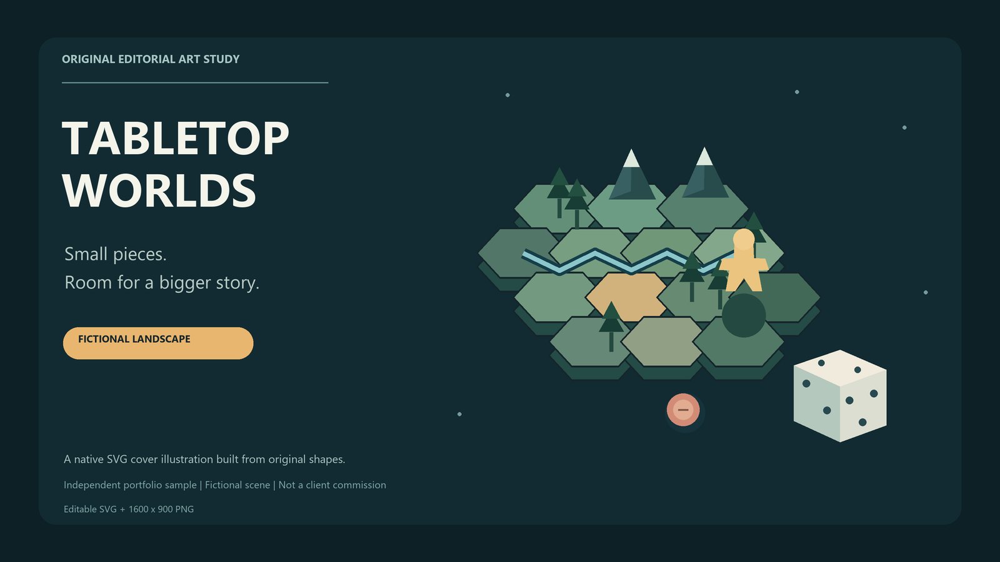

# Tabletop Worlds
An independent editorial illustration study: an original fictional tabletop landscape made from native vector shapes.

## Files
- `tabletop-worlds-study.svg`: editable native vector artwork.
- `tabletop-worlds-study.png`: 1600 x 900 PNG export.
- `draw_scene.py`: scene geometry and PNG/SVG generation source.
- `sample-spec.json`: sample provenance and limits.

The scene is fictional. This is a portfolio study, not a client commission, a game review, or a claim of playtesting. There are no client assets, brand logos, third-party artwork, embedded scripts or external image references. The SVG uses a system font stack; no font files are included.

Produced through a code-based workflow with Codex assistance. Python requires Pillow and uses installed Segoe UI fonts for the PNG; the SVG remains editable with a fallback sans-serif font stack. PNG typography may differ if re-rendered with another font.

All rights in this original sample are reserved by the account owner. This public portfolio display does not grant a commercial reuse licence. A commissioned graphic's commercial licence must be agreed separately.

## Checks
The SVG parses as XML and contains no script, external image or href elements. The PNG decoded at 1600 x 900 and was visually inspected for clipping and legibility. These are production checks, not customer acceptance or evidence of sales.

## Rollback
Unpublishing this repository removes the public portfolio copy. Local source and outputs remain in the experiment's artifacts folder.
